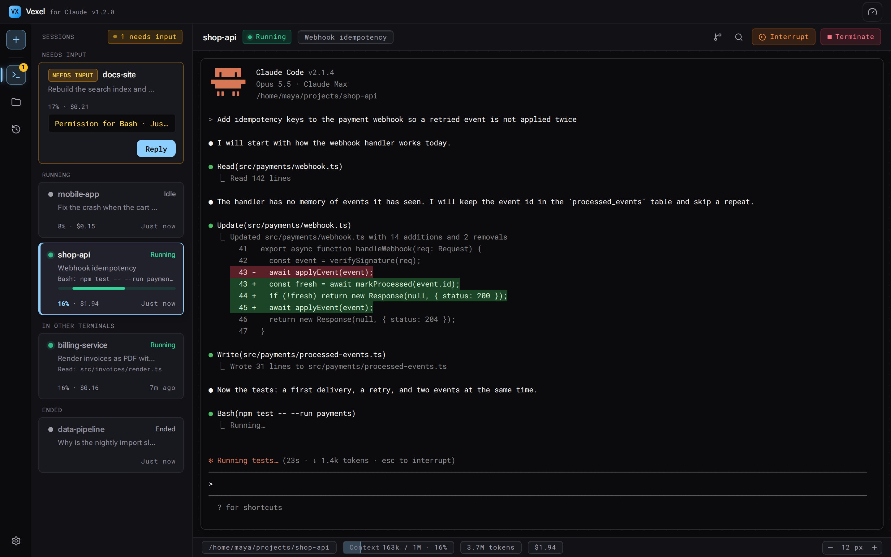
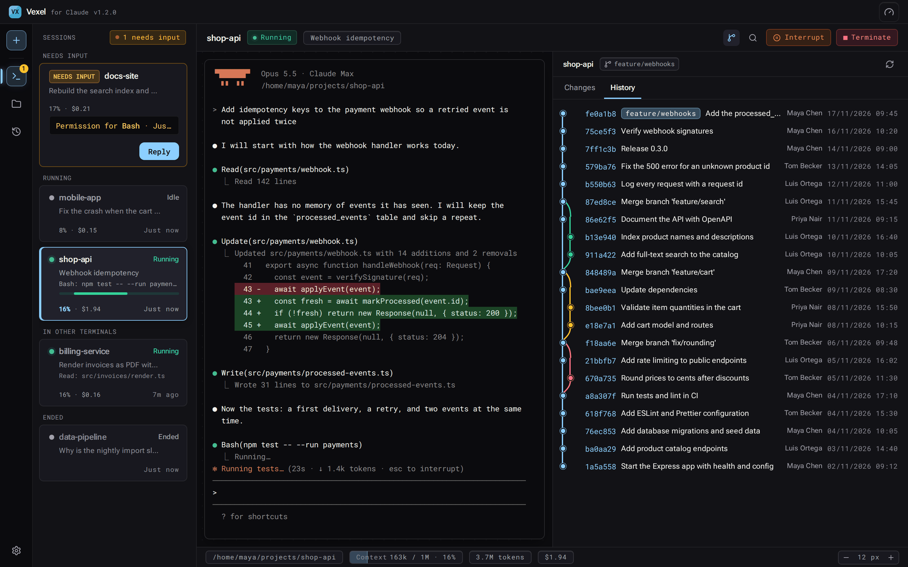
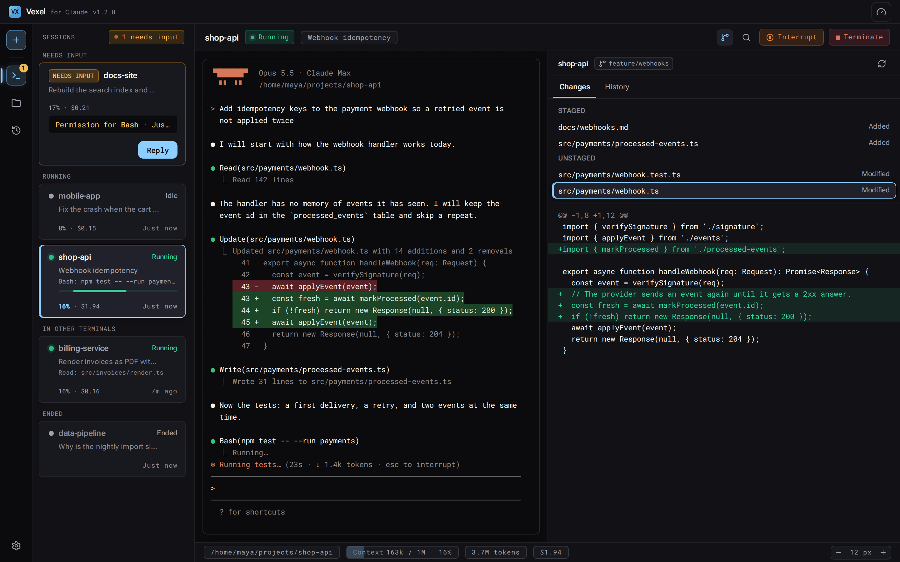
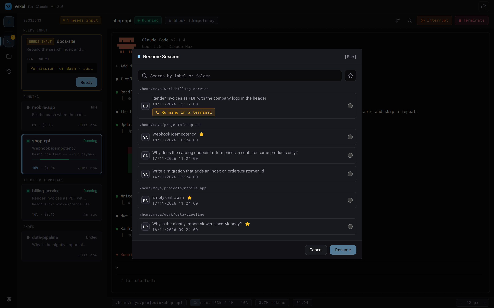
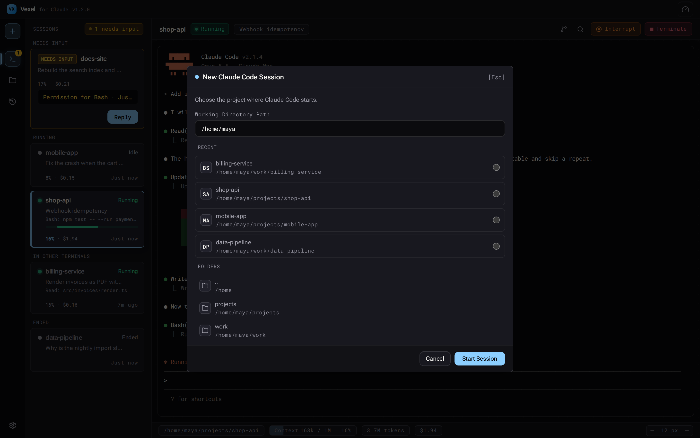
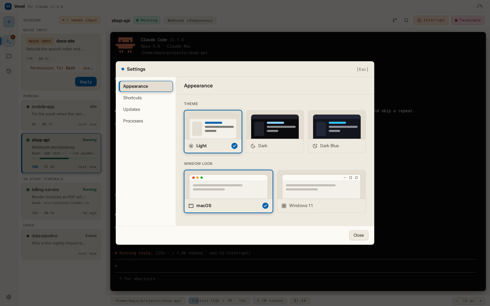
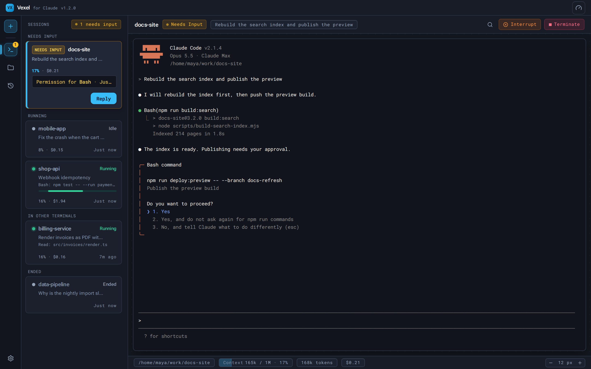

# Vexel for Claude

**One window for all your Claude Code sessions.** Run several interactive [Claude Code](https://code.claude.com) sessions side by side, see at a glance which ones are working, which need your input, and what each one costs.

[](https://github.com/91kr7/vexel-for-claude/actions/workflows/ci.yml)
[](LICENSE)


<p align="center">
  
</p>

<table>
  <tr>
    <td width="50%"><br><sub><b>Git explorer, History.</b> The commit graph with branches and merges.</sub></td>
    <td width="50%"><br><sub><b>Git explorer, Changes.</b> Staged and unstaged files with their diff.</sub></td>
  </tr>
  <tr>
    <td width="50%"><br><sub><b>Resume Session.</b> Past sessions by project, with favorites and search.</sub></td>
    <td width="50%"><br><sub><b>New session.</b> Recent projects and a folder browser.</sub></td>
  </tr>
  <tr>
    <td width="50%"><br><sub><b>Settings, Light theme.</b> Three themes and two window looks.</sub></td>
    <td width="50%"><br><sub><b>Dark Blue theme.</b> A session that waits for your answer.</sub></td>
  </tr>
</table>

<sub>Screenshots of the app with demo data: the projects, sessions, git history and terminal text are simulated.</sub>

> **Not affiliated with Anthropic.** Vexel for Claude is an independent, community project that drives the official `claude` command-line tool. "Claude" and "Claude Code" are trademarks of Anthropic, PBC.

## Why

Claude Code is a terminal tool. When you work on several tasks at once you end up with a pile of terminal tabs and no idea which one is waiting for you. Vexel puts them in one place and tells you when one needs attention.

## Features

- **Hosted sessions** – start Claude Code sessions inside the app, each in a real pseudo-terminal rendered with xterm.js.
- **External sessions** – sessions you started in another terminal show in their own group, and you can read them. Past sessions come from Claude Code's own history, and you can resume them.
- **Session states** – working, needs input, idle, ended. A badge counts the sessions waiting for you. A session that needs input shows which tool waits, and a **Reply** button.
- **Running tool** – a working session shows the tool it runs now, for example `Bash: npm test`.
- **Notifications** – a snackbar in the page, and in the desktop app system notifications and a tray icon, when a session needs your input.
- **Context, tokens and cost** – context window occupancy, tokens consumed and an estimated cost for every session, subagents included.
- **Plan usage** – your Claude plan limits and when they reset.
- **Git explorer** – the changes of the session's folder (staged and unstaged, with diffs) and its history as a commit graph with merges. A folder with several git repositories shows each repository in its own colour, and you can filter by repository. It refreshes at the end of each turn.
- **Projects** – a list of your projects with search and favorites. The new-session popup lists your recent projects and lets you browse folders.
- **Resume** – a popup with your past sessions grouped by project, with search, a star to mark favorites, and an *Only Favorites* filter.
- **Organise** – rename a session with the pencil on its entry, mark favorites, drag entries to reorder them, and resume or dismiss ended sessions.
- **Terminal comforts** – search, font zoom, clickable links, drag and drop files into the terminal.
- **Settings** – *Appearance* (Light, Dark and Dark Blue themes, and a macOS or Windows 11 window look), *Shortcuts* (change any key), *Updates* (check for a newer version) and *Processes* (see the processes of the app and end one).
- **Updates** – at launch the app checks GitHub for a newer release and shows the changelog of every release you miss.
- **Keyboard first** – a shortcut for navigation and for the main session actions. Open *Settings → Shortcuts* to see and change them.
- **Soft animations** – dialogs, panels and lists move gently. They turn off when your system asks for reduced motion.

## Platform support

| Platform | Status |
|----------|--------|
| **Ubuntu** | Fully supported. Developed and tested on Ubuntu 24.04 LTS (X11) |
| Other Linux distributions | Should work, but untested |
| **Windows with WSL 2** | Works since v0.4.0. Run Vexel in a Linux distribution under WSL 2. The desktop window shows through WSLg. There are no system notifications unless a notification service runs |
| **Windows (native)** | Not supported |
| **macOS** | Not supported |

Vexel relies on Linux desktop features: system notifications go through D-Bus (`org.freedesktop.Notifications`), the application-menu entry is a freedesktop `.desktop` file, and the project declares `os: linux`. WSL is a Linux environment, so the same code runs there. The *Windows 11* window look is only a style. It does not mean the app runs natively on Windows. A native Windows or macOS build is not planned for now.

## Requirements

- **Ubuntu** (or another Linux desktop, or a Linux distribution under WSL 2)
- **Node.js 22 or newer**
- The [`claude` CLI](https://code.claude.com/docs/en/setup) installed and logged in
- Build tools for the native `node-pty` module (`build-essential` and `python3` on Debian/Ubuntu)

## Install and run

```bash
git clone https://github.com/91kr7/vexel-for-claude.git
cd vexel-for-claude
npm install
npm run build
```

Then pick how you want to use it:

```bash
# Desktop window with tray icon (Electron). Starts the backend for you.
npm run desktop

# Add a "Vexel for Claude" entry to your Linux application menu
npm run desktop:install

# Or in a browser, at http://127.0.0.1:4001
npm start
```

Closing the desktop window does not stop your sessions: they keep running in the background and the tray icon brings the window back. Quit from the tray icon to stop them.

### Development

```bash
npm run dev          # backend + Vite dev server with hot reload
npm run build        # type-check and build the web client
npm test             # unit tests (run `npm run build` once first)
npm run test:e2e     # browser end-to-end tests (use a fake Claude CLI, never the real one)
```

To make the screenshots of this README again, run `npm run build && npx tsx e2e/readme-screenshots/capture.ts`. It starts its own demo server with invented data and never touches your sessions.

### Configuration

| Variable | Purpose |
|----------|---------|
| `PORT` | Backend port (default `3000`; `npm start` uses `4001`) |
| `CLAUDE_CONFIG_DIR` | Claude Code's config folder (default `~/.claude`) |
| `AI_CLIENT_CLAUDE_CLI` | Path of the `claude` executable to launch |
| `AI_CLIENT_DATA_DIR` | Where Vexel stores its own data (session names, favourites) |
| `AI_CLIENT_RELEASE_SOURCE_URL` | Where Vexel looks for newer releases (default: the GitHub releases of this project) |

## Privacy and security

Please read this before you install.

- **Local only.** The backend listens on `127.0.0.1` and rejects requests whose `Host` or `Origin` is not local, so other websites and other machines cannot reach your sessions.
- **It reads your Claude Code files.** To list sessions and compute usage it reads the transcripts under `~/.claude` (read-only).
- **It reads your Claude login token (for plan usage only).** The "Plan usage" view reads `claudeAiOauth.accessToken` from `~/.claude/.credentials.json` and sends it to `https://api.anthropic.com/api/oauth/usage`, the same endpoint Claude Code's `/usage` uses. The token never reaches the browser page and is never stored. That endpoint is undocumented, so it may change or stop working at any time, and you should decide for yourself whether you are comfortable with this use of your token.
- **It checks GitHub for updates.** At launch, and when you press *Check for Updates*, Vexel asks `https://api.github.com` for the latest release of this project and its changelogs. The request carries no token and no data about you or your sessions. These two requests are the only outbound network requests the app makes.
- **Hooks.** To know when a session needs input, Vexel starts the sessions it hosts with a temporary settings file that registers Claude Code hooks pointing at its own local backend. Your own `~/.claude/settings.json` is not modified.
- **Session content is sensitive.** Terminals, transcripts and git diffs can contain secrets. Be careful with screen sharing.

Found a vulnerability? See [SECURITY.md](SECURITY.md).

## Project layout

```
src/server/   Fastify backend: sessions, PTYs over WebSocket, git, history, usage
src/web/      React + Vite client
src/desktop/  Electron shell: window, tray, notifications
e2e/          Playwright end-to-end tests
.sdd/         Specs, plans and analyses the app was built from
.claude/      The spec-driven development workflow (agents, commands, conventions) used to build it
```

The project was developed with a spec-driven workflow: every feature has a written analysis, a plan and component specs under `.sdd/`, and the code is derived from them. They double as documentation of why things work the way they do.

## Contributing

Contributions are welcome. Read [CONTRIBUTING.md](CONTRIBUTING.md) first, and please open an issue before starting a large change.

## Third-party software

See [THIRD-PARTY-NOTICES.md](THIRD-PARTY-NOTICES.md) (Roboto fonts, Lucide icons).

## License

[MIT](LICENSE) © 2026 91kr7
